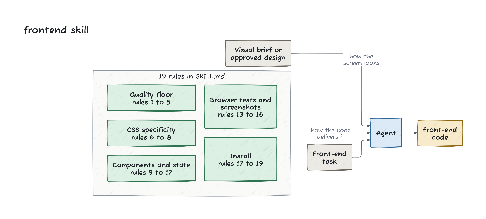

# frontend-skill

[](https://github.com/asabirov/frontend-skill/releases)
[](LICENSE)

An agent skill with rules for front-end code. The agent reads it when it builds, changes, reviews or fixes a web front end.



## Install

Install the latest version:

```sh
DO_NOT_TRACK=1 npx skills add https://github.com/asabirov/frontend-skill --skill frontend --agent claude-code codex --global -y
```

Update it later:

```sh
DO_NOT_TRACK=1 npx skills update frontend --global
```

`DO_NOT_TRACK=1` turns off the telemetry of the skills CLI. The CLI needs Node.js, npm and Git.

Then ask your agent to build or fix a screen.

| To | Do |
| --- | --- |
| Remove | `DO_NOT_TRACK=1 npx skills remove frontend --agent claude-code codex --global -y` |
| Turn off the skills CLI telemetry | Keep `DO_NOT_TRACK=1` |

| Dependency | Needed for |
| --- | --- |
| Node.js 22.20 or later, npm and Git | Running the install command |
| An agent that reads Agent Skills | Loading `SKILL.md` |

## What it prevents

| Mistake that agents repeat | Rule |
| --- | --- |
| Layouts that overflow on a phone | 1, 2 |
| Removed focus outlines | 3 |
| CSS rules that cancel each other out | 6 |
| Browser tests that depend on the local time zone | 14 |
| Screenshots of an old build | 15 |
| Lockfiles that a different npm rewrites | 18, 19 |

## What it turned down

| Candidate | Why not |
| --- | --- |
| Visual rules | A visual brief or an approved design sets the look, so the two cannot conflict |
| Copying the whole upstream `frontend-design` skill | Most of it is visual direction, and a visual skill covers that |
| A framework or a stack choice | The rules must hold in React, Svelte, Vue and plain HTML |
| Size, complexity and duplication limits | A code-size check holds them |

## Other skills

Before the first release, each rule was compared with these skills. No rule conflicts with or repeats one of theirs.

| Skill | It covers | This skill |
| --- | --- | --- |
| `design` | The look: reflow at narrow widths, visible focus, reduced motion, states to render, design tokens, native controls | How code delivers those results, such as `:focus-visible` and the reduced-motion media query. No tokens or native controls |
| `code-smells` | Code size, complexity, duplication, imports | No size or duplication limit |
| `agent-browser` | How to drive a browser and take a screenshot | Which page to capture |
| `run` | How to start the app | A fresh build before a screenshot |

## Licence

Apache License 2.0. Part of `SKILL.md` adapts the `frontend-design` skill from [anthropics/skills](https://github.com/anthropics/skills). See `NOTICE`.
